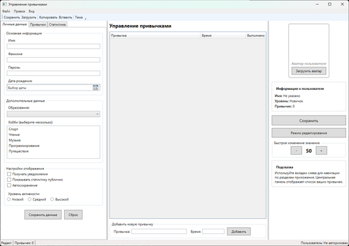
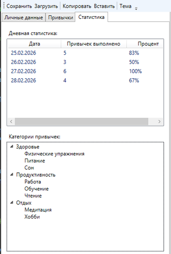

# Lab1 — Управление привычками (WPF)

Лабораторная работа по дисциплине «Программная инженерия»: приложение для ведения
персональных данных и привычек, написанное на WPF без использования паттерна MVVM.

## Возможности

- вкладка «Личные данные»: имя, фамилия, пароль, дата рождения, образование, хобби,
  флажки уведомлений и настроек отображения, уровень активности;
- вкладка «Привычки»: добавление привычек, отметка выполнения в таблице, оценка
  продуктивности и удовлетворённости ползунками, пересчёт прогресса дня;
- вкладка «Статистика»: дневная статистика в списке и дерево категорий привычек;
- переключение тёмной и светлой темы, загрузка аватара через диалог выбора файла;
- сохранение профиля, привычек и темы в JSON-файл с восстановлением при запуске.

## Требования

- Windows 10 или 11;
- .NET Framework 4.7.2 Developer Pack (для сборки).

## Сборка и запуск

```powershell
dotnet build .\WpflLab1.csproj
```

Либо открыть `WpflLab1.slnx` в Visual Studio и запустить проект.

## Где хранятся данные

`%AppData%\WpflLab1\state.json` — профиль, привычки и признак тёмной темы. Файл
создаётся при первом сохранении. Запись выполняется через временный файл, поэтому
при сбое старые данные не теряются.

## Скриншоты

| Личные данные | Статистика |
|---|---|
|  |  |

## Структура

```
MainWindow.xaml, MainWindow.xaml.cs   разметка и логика окна
UserProfile.cs, Habit.cs              модели данных
DailyStatistic.cs                     модель строки статистики
Storage/StateStorage.cs               чтение и запись состояния в JSON
WpflLab1.csproj                       проект WPF (.NET Framework 4.7.2)
```
